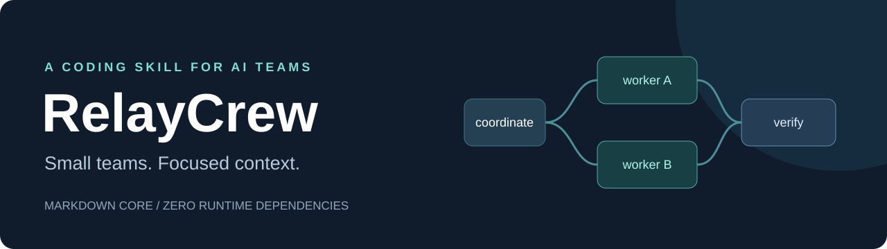

# RelayCrew

## Parallel AI coding. Clear ownership.

Turn one coding request into focused handoffs and a coordinated result. **RelayCrew is a portable Agent Skill** that helps small AI teams divide work, avoid overlapping edits, and verify the combined change.

Keep the coding assistant you already use. The core is Markdown; an optional offline planner uses Node.js built-ins. No RelayCrew account, API key, server, or background process.

**[Download the skill](https://github.com/ScriptNegative/relaycrew/releases/latest) · [Try a real coding task](evals/README.md) · [See the evidence](evals/results.md)**

## The problem

Two agents change the same lockfile. A worker misses an interface decision. Review starts before a failed prerequisite is fixed. Parallel progress becomes integration cleanup.

Native subagents can start the work. The boundaries and handoffs still need a plan.

## The solution

RelayCrew gives the coordinating agent a small repeatable workflow: choose the smallest useful team, assign explicit ownership, send focused briefs, and check the integrated result. The optional planner makes declared overlaps and dependency holds visible before dispatch.

Small tasks stay solo in automatic mode. A larger independent queue runs in bounded waves.

## How it works

1. **Agree on the contract.** Identify the required outcome and shared interfaces.
2. **Divide compatible work.** Give each worker clear read/write paths and checks.
3. **Relay the essentials.** Send relevant facts and source locations in a short brief.
4. **Verify, then continue.** Hold failed dependencies and inspect the combined change.

Choose auto, solo, team, or review mode in your prompt. Adjust the worker ceiling, briefing target, and checkpoints when useful. [Options and example prompts](skills/relaycrew/references/options.md).

## Quick demo

Node.js 18+ is enough. No npm install is needed:

```sh
git clone https://github.com/ScriptNegative/relaycrew.git
cd relaycrew
node skills/relaycrew/scripts/plan.mjs examples/shared-lockfile.plan.json --format markdown
```

```text
Wave 1: api-deps + docs
Wave 2: ui-deps
```

The two dependency updates both claim the lockfile, so they run in sequence. Separate documentation work can proceed alongside the first update. The output explains the overlap.

Try two other patterns:

```sh
node skills/relaycrew/scripts/plan.mjs examples/feature.plan.json --format markdown
node skills/relaycrew/scripts/plan.mjs examples/failure-resume.plan.json --format markdown
```

The second holds documentation and review behind a failed API task while unrelated UI work remains eligible. These commands plan work; they do not launch agents.

Get all handoff briefs for the next compatible wave in one command:

```sh
node skills/relaycrew/scripts/plan.mjs examples/feature.plan.json --next --format markdown
```

This emits only `api` and `ui`, leaving `docs` and `review` for later. Omit `--format markdown` for a JSON bundle. If no work can proceed, the bundle distinguishes a failure hold from an all-completed checkpoint. The coordinator still verifies state and controls dispatch.

## Use cases

| Task | Useful pattern |
| --- | --- |
| API and frontend feature | Freeze the interface, split implementation, check the integrated result |
| Several plausible bug causes | Independent read-only investigations before choosing a fix |
| Dependency changes sharing a lockfile | One owner at a time, with explicit ordering |
| Interrupted implementation | Verify completed state, hold failed prerequisites, resume compatible work |
| A change needing another perspective | Independent read-only review when native delegation permits it |
| A tiny dependent edit | Solo execution without creating a team |

## Installation

Download the ZIP from [Releases](https://github.com/ScriptNegative/relaycrew/releases/latest), or copy the complete [`skills/relaycrew`](skills/relaycrew) folder from this repository. Keep the bundled references and script together.

| Host | Project installation or route | Invocation |
| --- | --- | --- |
| Codex | `.agents/skills/relaycrew/` | `$relaycrew` |
| Claude Code, local project | `.claude/skills/relaycrew/` | `/relaycrew` |
| VS Code with Copilot | `.agents/skills/relaycrew/` | Confirm discovery in the host's skills UI |
| OpenCode | `.opencode/skills/relaycrew/` or its documented compatibility directory | Ask the host to load `relaycrew` |
| ChatGPT | Supported desktop skill flow, or a separately distributed plugin | Select the installed skill with `@` |
| Other compatible agents | Their supported Agent Skills loader | Host-specific |

For example, from a target project with this repository cloned alongside it:

```sh
mkdir -p .agents/skills
cp -R ../relaycrew/skills/relaycrew .agents/skills/
```

PowerShell:

```powershell
New-Item -ItemType Directory -Force .agents/skills | Out-Null
Copy-Item -Recurse ../relaycrew/skills/relaycrew .agents/skills/
```

Replace the destination for your host. If the folder already exists, review and replace it deliberately. Reload skills if the host requires it. [Host notes and official documentation](skills/relaycrew/references/hosts.md) distinguish local, cloud, and ChatGPT distribution paths.

Optional community installer, with Node.js 22.20+ and its own installation/telemetry behavior:

```sh
npx skills add ScriptNegative/relaycrew --skill relaycrew
```

That command uses the separate [Vercel Skills CLI](https://github.com/vercel-labs/skills); manual installation requires no installer. Choose your target host in its prompt.

Then give your assistant a task:

```text
Use RelayCrew in team mode with at most two workers for this feature.
Agree on shared interfaces, assign exclusive write paths, and verify the
integrated result. Use only delegation that this host actually permits.
```

## Real coding examples and evidence

The [evaluation fixtures](evals/README.md) include CSV export and an offline event report. They start as incomplete modules with frozen contracts and acceptance tests so another user can try the same task.

A Codex team run used two independent implementers and a coordinating integrator; all 23 resulting checks passed. A small CSV run stayed solo. The CSV baseline also passed without the skill. These are exploratory feasibility checks, not proof of faster or cheaper work. [Results and limitations](evals/results.md).

The planner and copied-package tests run in [GitHub Actions](https://github.com/ScriptNegative/relaycrew/actions) on Node 18/22 on Linux and Node 22 on Windows.

## Before and after the plan

| Unstructured task split | RelayCrew workflow |
| --- | --- |
| Two workers both claim the lockfile | Declared overlap is explained; the plan separates their waves |
| Every worker receives a copied transcript | A focused brief points to the relevant contract, files, and checks |
| A downstream task starts after an upstream failure | Failed task state holds its transitive dependents |
| A worker's “done” is the integration gate | The coordinator inspects evidence and runs the acceptance checks |

This comparison describes workflow behavior, not a measured speed or cost improvement.

## FAQ

**Is RelayCrew an agent framework?**

It is an instruction workflow with an optional static planner. Native agents and tools come from the host you already use.

**Does it work with any agent?**

The package follows Agent Skills conventions and avoids hardcoded tool APIs. Installation, delegation, editing, and execution capabilities vary by host. Codex behavior has been exercised in the published runs; Claude Code, ChatGPT surfaces, Copilot, and OpenCode setup is documented, with live runtime verification still limited. A plain chat can use planning or review instructions without becoming an execution environment.

**Does it prevent every conflict?**

The planner only sees declared literal paths and resources. It does not lock files, resolve path aliases, or discover hidden side effects. The coordinator must enforce ownership.

**Does it save tokens or time?**

No general savings claim has been established. Short briefs and a small team are workflow choices. Actual usage must include all workers and be compared against a disclosed baseline.

**What happens when a task fails?**

Record verified `completed` and `failed` task IDs. The planner holds dependent work and can continue unrelated tasks. `--next` bundles the next wave's capsules; `--brief ID` emits one eligible capsule and explains whether a denied task is failed, blocked, completed, or waiting for a later wave. [Planner format and recovery](skills/relaycrew/references/planner.md).

**Can I use it without Node.js or delegation?**

Yes for the instruction workflow, within the tools your host provides. Node is needed only for the optional planner. Without native delegation, disclose solo execution. Without source or execution access, provide a plan or reasoned review and state the gap.

**Does RelayCrew add a service charge?**

The project is MIT licensed and has no service account. Your assistant's normal subscription or API usage still applies.

## Contribute

Try one real task and share what happened. Include the host/version, task split, minimal plan, and checks; remove private source and credentials. Reproducible failure cases, host validation, useful workflows, and measured comparisons are especially helpful. See [contribution guidance](CONTRIBUTING.md).

Run the local checks with Node.js 18+:

```sh
node --test tests/plan.test.mjs tests/package.test.mjs
```

If RelayCrew helps, a star makes it easier to find again. A concrete observation helps make it better.

MIT · [ScriptNegative](https://github.com/ScriptNegative) · Independent project using the [Agent Skills standard](https://agentskills.io/specification).
